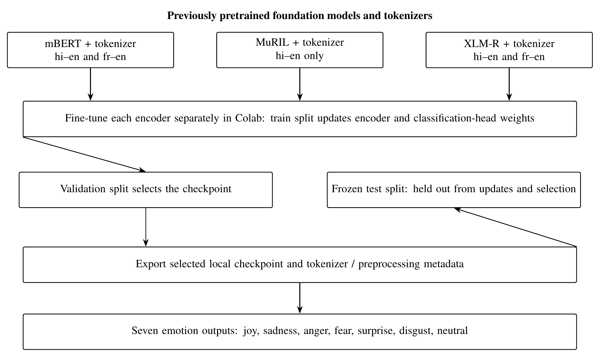

# CodeMood: An Auditable Framework for Seven-Class Emotion Recognition in Hindi-English and English-French Code-Mixed Text

## Abstract

Informal code-mixed messages combine language switching, spelling variation, emoji and context-dependent meaning, complicating both emotion recognition and its evaluation. This paper presents CodeMood, an auditable framework for seven-class emotion recognition in Hindi-English and English-French text. Four modules connect language-compatible transformer inference, cue analysis and selective contextual review, matched evaluation, and reproducible training with an audited annotation handoff. The local interface preserves checkpoint identity, base score distributions, overlap checks and review provenance. On a fixed 2,000-row synthetic bilingual test partition, fine-tuned XLM-R obtains 92.5% accuracy and 0.9251 macro-averaged F1, which averages each class's harmonic mean of precision and recall, compared with 81.4% and 0.8119 for multilingual BERT. A sequential replay on a local processor using the same 1,000 Hindi-English test rows reproduces 95.6%, 84.3% and 80.3% accuracy for XLM-R, multilingual BERT and MuRIL, respectively, with no detected exact training/validation overlap under the available guards. Unequal training scopes prevent interpreting this three-model comparison as an isolated encoder effect. Paired errors expose complementary failures without implying an ensemble gain or statistical significance. Separate draft-labelled checking phrases reveal distribution sensitivity, while a 98-row validation experiment illustrates temperature fitting without changing predicted labels. The contribution is an inspectable connection between inference, diagnosis and controlled model development. All model-quality findings remain conditional on synthetic or draft-labelled data; independently annotated natural-language effectiveness and optional fusion or reviewer gains are unmeasured.

**Index Terms:** Code-mixed emotion recognition, multilingual encoders, matched evaluation, confidence calibration, reproducible training.

## 1 Introduction

A phrase such as "aaj presentation mast tha" combines Hindi syntax, English vocabulary and informal Roman spelling. Elongated forms such as "acchaaa" may express emphasis, hesitation or irony. An emoji may reinforce the words or conflict with them, while "great, another delay" can reverse its literal positive wording. Three-way sentiment gives a broad positive, negative or neutral direction; it does not distinguish sadness from anger, fear or disgust. A useful interface must therefore identify the task, expose uncertainty and preserve the evidence used to produce a result.

Multilingual contextual encoders offer a practical starting point because they learn token representations across languages [@devlin2019,conneau2020,khanuja2021]. Their pretrained representations still require supervised task adaptation. A pretrained model identifier alone is not a seven-emotion classifier. Language coverage also differs: the Indian-language encoder is appropriate to the Hindi-English study, whereas the cross-lingual and multilingual encoders support the bilingual comparison considered here. The linguistic variability described by code-mixed resources makes evaluation on a distinct phrase set essential [@aguilar2020,vijay2018].

The central research question is how to connect these encoders into a reproducible local system in which model disagreement, ambiguous cues and training provenance remain inspectable. We implement four modules: language-aware preparation and checkpoint inference; cue analysis and selective contextual review; evaluation and encoder disagreement; and reproducible training with audited annotation handoff. A Streamlit dashboard connects the modules without duplicating classifier logic. Command-line entry points support dataset preparation, evaluation and checkpoint installation.

The principal systems contributions are a seven-label checkpoint contract with language checks; sequential evaluation that scores every selected encoder on a common eligible row set; and an audited review workflow that protects frozen evaluation examples during correction export. The framework also implements a text-emoji fusion architecture as an extension point for supervised experiments. The present study evaluates the installed text encoders and an experimental confidence profile, retaining the original model scores whenever contextual review is requested. It contributes a reproducible integration and evaluation method rather than a new pretrained encoder. Neither encoder agreement nor a high confidence score establishes correct interpretation of a phrase.

## 2 Related Work

### 2.1 Multilingual Encoders and Code-Mixed Evaluation

The Transformer supplies the attention-based architecture underlying modern contextual encoders [@vaswani2017]. BERT established supervised task adaptation of pretrained representations [@devlin2019], while multilingual BERT demonstrated cross-language transfer with language-dependent limitations [@pires2019]. XLM-R extended multilingual representation learning through large-scale pretraining [@conneau2020]. MuRIL instead emphasizes Indian languages and transliterated text [@khanuja2021]. These models provide different starting representations; none is a seven-emotion classifier before a compatible output head is trained. Accordingly, CodeMood treats the tokenizer, fine-tuned encoder, label map, preprocessing policy and language metadata as one inference contract.

Cross-language representation quality must also be distinguished from performance on a particular code-mixed task. XTREME emphasizes evaluation across languages and tasks [@hu2020], and LinCE organizes code-switching resources under explicit task definitions [@aguilar2020]. GLUECoS investigates code-switched evaluation and adaptation, including the role of generated data [@khanuja2020]. These studies motivate reporting language-specific results and documenting the origin and partitioning of generated examples. CodeMood records language-pair identifiers, dataset and split hashes, and synthetic status so that an aggregate score can be traced to its actual scope.

Task labels require equal care. SentiMix evaluates three-way sentiment in code-mixed tweets [@patwa2020], whereas the present task distinguishes seven emotions. Its published sentiment scores therefore cannot serve as matched emotion baselines. The Hindi-English corpus of Vijay et al. provides emotion annotations and linguistic information [@vijay2018]; GoEmotions offers a finer English emotion taxonomy [@demszky2020]; and Affect in Tweets distinguishes emotion, intensity and valence objectives [@mohammad2018]. Their differing categories and annotation settings preclude treating labels as interchangeable. The proposed framework enforces a declared seven-label schema and keeps sentiment, emotion and heuristic intensity outputs separate. It neither relabels these external corpora automatically nor claims a direct benchmark comparison with them.

### 2.2 Emoji, Sarcasm and Conversational Context

Emoji can carry affective evidence that complements or conflicts with surrounding text. Felbo et al. demonstrate emoji prediction as a form of distant supervision [@felbo2017], while Kralj Novak et al. provide an empirical emoji sentiment lexicon [@kraljnovak2015]. Barbieri et al. benchmark emoji prediction in English and Spanish [@barbieri2018]. CodeMood uses these insights at two distinct levels: an inspectable lexical conflict diagnostic and an optional learned emoji branch. The learned branch is an implemented architecture, whereas its contribution to emotion accuracy remains unmeasured. Paired emoji-removal experiments likewise report prediction stability unless an appropriate target label or explicit invariance assumption is supplied.

Sarcasm requires separate supervision because literal polarity and intended affect can diverge. Van Hee et al. distinguish binary and fine-grained irony [@vanhee2018], and Aggarwal et al. study supervised Hindi-English sarcasm detection [@aggarwal2020]. CodeMood therefore keeps its heuristic sarcasm cues separate from the optional supervised binary head. Unknown sarcasm labels are masked during training, and an untrained head is not exposed as a probability. This is a supervision safeguard, not evidence that the framework reproduces or improves upon those systems.

Conversational context can resolve ambiguities that isolated phrases leave open. Ghosh et al. investigate its use in sarcasm analysis [@ghosh2018]; MELD situates affective labels within multiparty dialogue [@poria2019]; and EDiReF distinguishes conversational emotion recognition from emotion-flip reasoning [@kumar2024]. The proposed text-only interface preserves earlier turns and speaker identity, but does not claim multimodal equivalence or infer causes from a predicted label change. Context-conditioned encoder inference is permitted only when checkpoint metadata declares training for that input contract. Existing text-only checkpoints remain phrase classifiers, and local language-model review constitutes a separate, empirically unevaluated contextual route.

### 2.3 Confidence, Disagreement and Reproducibility

Guo et al. characterize neural miscalibration and temperature scaling [@guo2017], while Ovadia et al. show that uncertainty quality can deteriorate under dataset shift [@ovadia2019]. These findings motivate binding a fitted profile to its checkpoint, language and preparation settings rather than treating it as a universal confidence correction. CodeMood restricts fitting to validation or dedicated calibration rows and preserves the predicted class. Its small validation example illustrates the mechanism; it does not establish calibration on naturally occurring code-mixed messages.

Deep ensembles provide one approach to uncertainty estimation [@lakshminarayanan2017]. CodeMood instead runs heterogeneous installed checkpoints sequentially and exposes their individual outputs. This resource-constrained inspection procedure is not a reproduction of a trained deep ensemble. Jensen-Shannon divergence and its square-root distance quantify differences between aligned distributions [@lin1991], while paired correctness counts show whether those differences correspond to errors on the same labelled rows. Selective prediction formalizes risk-coverage trade-offs [@geifman2017]; the framework adapts the operational idea through explicit review reasons, coverage and timing, with heuristic thresholds rather than certified risk guarantees.

Annotation and provenance are equally central to reproducibility. Multi-annotator modeling preserves individual judgments [@davani2022], and Plank emphasizes that label variation can reflect legitimate differences in interpretation [@plank2022]. CodeMood retains reviewer identifiers, notes and context requests, separates proposed labels from blinded reviewer sheets, and requires adjudication when necessary. Dataset documentation [@gebru2021] and linguistic data statements [@bender2018] motivate its records of synthetic ancestry, language coverage and preprocessing. Audited correction export permits eligible additions to training while protecting frozen validation and test partitions.

Finally, CheckList demonstrates the value of capability tests beyond aggregate accuracy [@ribeiro2020], and Dror et al. explain why statistical tests must match the experimental design [@dror2018]. The present work combines controlled input variants, leakage guards and paired prediction records to make such analysis possible. No significance test is reported. XLM-R and mBERT share a 16,000/2,000/2,000 bilingual synthetic split, whereas MuRIL uses 8,000/1,000/1,000 Hindi-English rows. Matching test inputs controls the evaluated phrases but does not remove this training-scope difference. The methodological contribution is therefore an auditable path from prediction through diagnosis and annotation to controlled retraining, with empirical claims bounded by the measured data.

## 3 System Architecture and Methods

CodeMood accepts one phrase, a bounded conversation, or a structured CSV/XLSX file. The request includes a task and language mix. Three-class sentiment and seven-class emotion use separate output contracts. The selected local checkpoint is validated before tokenization; missing or incompatible artifacts produce an explicit interface message. Normalization, lexical cues, calibration, reviewer suggestions and model outputs retain distinct sources. [[fig:master_architecture]] summarizes the four modules and their shared data contracts.


The application contains eight workspaces: Overview, Analyze text, Emotion lab, Model effectiveness, Model comparison, Dataset explorer, Model disagreement and Research workbench. Recent live analyses remain in session memory until the user exports them. Dataset and correction downloads require an explicit action; a prediction does not mutate training data or model weights. Model identity, task, supported language pairs, preparation policy and artifact fingerprints accompany the inference route.

The Overview presents seven-emotion analysis as the principal task, with three-way sentiment retained as a separate application. This distinction also governs checkpoint discovery: a model trained for sentiment cannot acquire an emotion interpretation merely because its encoder family matches. The four modules share the same emotion order, language identifiers and preprocessing metadata, so results can move between phrase analysis, evaluation and review without redefining the task. The traceability map in [[tab:feature_traceability]] connects the principal capabilities to their implementation locations and current evidence. Paths are relative to the repository root; a path identifies available functionality rather than an independently validated effectiveness claim.

| Capability | Workspace and Source Path | Evidence Status |
|---|---|---|
| Seven-emotion inference | Emotion lab; `hinglish_emotion/emotions.py` | Installed text checkpoints; synthetic test results |
| Cue analysis and local review | Emotion lab; `hinglish_emotion/ollama_emotion_reviewer.py` | Operational checks; Qwen gain unmeasured |
| Matched evaluation and disagreement | Model comparison; `hinglish_emotion/model_comparison.py` | Same-row replay and descriptive paired errors |
| Training and audited handoff | Research workbench; `training/train_transformer.py`, `training/review_workflow.py` | Completed text-model runs; correction safeguards checked |
| Optional supervised extensions | `training/train_advanced.py`, `hinglish_emotion/fusion.py` | Code available; no installed trained fusion, context or sarcasm weights |

The interface distinguishes three kinds of evidence throughout this map. An installed checkpoint can support a measured prediction result within its recorded scope. A tested software path establishes that a contract or guard behaves as implemented. A training-ready extension establishes only that the code can consume the required supervision and export an artifact. Combining these statuses into one feature list would obscure which capabilities were actually evaluated. In particular, the optional extensions and human correction loop are not credited with the text-only encoder scores.

### 3.1 Language Preparation and Seven-Emotion Inference

The first module handles common Romanized spellings conservatively, records elongated forms, and preserves negation. It retains both the original phrase and the normalized candidate. A checkpoint's metadata determines whether raw or normalized text reaches its tokenizer. This prevents a convenient interface transformation from silently changing the preprocessing used during training. Token-length limits are enforced, and truncation is surfaced with the result.

**Encoder Architecture and Tokenization**

The installed base configurations share a twelve-layer bidirectional Transformer encoder, hidden dimension 768, twelve attention heads and a feed-forward intermediate dimension of 3,072. Each head therefore operates on a 64-dimensional partition of the hidden state before the attention outputs are recombined. Within each encoder layer, self-attention allows a token representation to depend on the other tokens, and a position-wise feed-forward transformation further updates that representation. Residual connections and layer normalization support the stacked computation. These common dimensions, summarized in [[tab:encoder_properties]], do not make the three pretrained models identical: embedding vocabularies, token segmentation, pretraining material and learned parameter values differ.

| Encoder | Layers / Hidden / Heads | Vocabulary Entries | Tokenizer Model |
|---|---|---:|---|
| mBERT | 12 / 768 / 12 | 119,547 | WordPiece |
| MuRIL | 12 / 768 / 12 | 197,285 | WordPiece |
| XLM-R | 12 / 768 / 12 | 250,002 | SentencePiece Unigram |

The vocabulary sizes and encoder dimensions are read from the installed configuration files; tokenizer model types are checked in the exported tokenizer artifacts. They describe these actual model exports rather than every possible member of each encoder family. The mBERT and MuRIL exports use BERT sequence-classification architectures, whereas the XLM-R export uses the corresponding XLM-R sequence-classification architecture. Both routes produce seven ordered logits after task adaptation. The vocabulary table does not report parameter counts or establish that a larger vocabulary must yield better accuracy.

BERT learns bidirectional representations from unlabelled text before task-specific fine-tuning [@devlin2019]. Its multilingual variant shares parameters and subword representations across languages, permitting transfer while retaining language-dependent behavior [@pires2019]. XLM-R uses large-scale multilingual masked-language-model pretraining, including filtered CommonCrawl material across one hundred languages [@conneau2020]. MuRIL concentrates on Indian-language representation and augments its pretraining material with translated and transliterated document pairs [@khanuja2021]. These are properties of the inherited pretrained representations, not training steps performed by CodeMood.

The tokenizers turn variable-length strings into the integer sequences expected by those inherited embeddings. WordPiece and Unigram use different learned segmentation models, and their vocabulary sizes need not correspond to the same words or character sequences. Romanized spellings, accents, punctuation and emoji may consequently yield different subword sequences and token lengths for the same phrase. For example, an elongated spelling such as "acchaaa" should be inspected through each checkpoint's own tokenizer rather than assigned an invented common segmentation. A shared 128-token task limit controls the maximum sequence length, but does not guarantee that every encoder retains the same amount of visible text. Truncation is therefore recorded per checkpoint.

CodeMood's supervised adaptation begins after this pretraining. The seven-emotion classification head is learned against the declared labels, and the recorded experiments update the full encoder rather than freezing it. The project does not retrain the pretrained vocabulary or repeat the original language-model pretraining. The learned head and adapted encoder must remain paired with their tokenizer, label order and preprocessing metadata at export. This separation is important when interpreting results: the study compares fitted task configurations that inherit different linguistic representations, while its own supervision remains the synthetic emotion corpus described below.

The installed classifiers are a combined XLM-R checkpoint, a bilingual mBERT checkpoint, a Hindi-English MuRIL checkpoint and an original Hindi-English XLM-R checkpoint. Each consists of its tokenizer, encoder, trained classification head, label map and task metadata. For each tokenized phrase, the encoder produces a contextual representation h. A trained classification head maps h to a seven-element logit vector z using learned weights and bias. The first expression converts the logit for emotion k into its normalized score `p_k`; the second selects the index of the largest score as the predicted label, y-hat. The denominator in softmax includes every emotion, so increasing one class score changes the normalized mass available to the others.

[[equation:softmax]]

[[equation:argmax]]

The trained head assigns one logit to each emotion: joy, sadness, anger, fear, surprise, disgust and neutral. Softmax converts these logits into nonnegative scores that sum to one; the largest score determines the displayed base label. The maximum is neither measured emotion intensity nor independently verified correctness probability. The seven-class output contract in [[tab:emotion_labels]] is shared by training, inference and exported files.

| Checkpoint Output | Meaning in the Task |
|---|---|
| joy | Happiness, satisfaction or positive delight |
| sadness | Loss, disappointment or sorrow |
| anger | Frustration, irritation or hostility |
| fear | Anxiety, apprehension or perceived threat |
| surprise | Unexpectedness or astonishment |
| disgust | Aversion or strong rejection |
| neutral | No dominant target emotion in the phrase |

The labels describe perceived or expressed content under the dataset convention rather than a psychological assessment of the writer. Checkpoint validation rejects a three-class sentiment head used as a seven-emotion head and checks that the requested language is compatible with the export.

Language eligibility is enforced at inference, not merely by hiding options in the interface. When a checkpoint declares known `trained_language_pairs` and the requested pair is absent, every inference route rejects the request. Thus, MuRIL does not receive a fabricated English-French result through a custom path or batch request. A legacy checkpoint whose language coverage is unknown remains explicitly experimental; missing metadata is not interpreted as verified support for both pairs. Trained coverage is also distinct from independently validated coverage: a checkpoint can have supervised exposure to a language without a representative human-labelled test for that language.

The implemented fusion variant adds a learned emoji branch to the XLM-R text vector. Emoji sequences, including modifiers and joined sequences, are mapped to versioned hash buckets, embedded, pooled and projected. A learned vector gate forms a residual text-plus-emoji representation. When the phrase contains no emoji, the gate contribution is forced to zero. This design differs from the lexical emoji conflict diagnostic: one is a trainable representation, the other is a transparent rule cue. Optional context is encoded using the current phrase first and the remaining token budget for earlier turns. An auxiliary binary sarcasm head shares the fused representation and masks rows without independently reviewed sarcasm labels. The quantitative encoder study concerns the installed text-only checkpoints. [[fig:encoder_adaptation]] distinguishes this measured path from the optional supervised branches.



**Algorithm 1: Seven-Emotion Checkpoint Inference**

```text
Input: phrase x, language l, checkpoint c
1. Validate c.task, seven labels and language l.
2. Preserve x; compute normalization record n.
3. Choose raw x or n.text from c.metadata.
4. Tokenize within c.max_length; flag truncation.
5. Encode tokens into a contextual representation.
6. If c enables fusion, add gated emoji state.
7. Apply trained head; normalize logits into p.
8. Return argmax(p), p, source and warnings.
```

### 3.2 Cue Analysis, Confidence and Contextual Review

The second module provides a separate diagnostic path for lexical polarity, elongation, negation and emoji cues. Word-only polarity is compared with emoji polarity to describe agreement, conflict or ambiguity. Sarcasm uses a labelled heuristic baseline unless an independently supervised sarcasm model is explicitly installed. Valence/arousal intensity and evidence words are shown as heuristic outputs; they are not presented as transformer attention or feature attribution.

Uncertainty routing considers the top score, the gap between the two leading scores, truncation, contextual input, experimental language scope, emoji conflict and sarcasm cues. For the score rule, a top score below 0.55 or a margin below 0.15 marks an uncertain result. These thresholds are operational choices rather than calibrated error guarantees. A matching temperature profile rescales the stored scores. In the equation below, T is the fitted temperature and the denominator renormalizes all seven classes.

[[equation:temperature]]

Scaling stored probabilities is equivalent to softmax of log probabilities divided by temperature. Zero entries remain zero. A temperature above one generally softens the distribution, while a value below one sharpens it. Positive scalar scaling preserves class ordering; it changes confidence scores rather than repairing a wrong label. The implementation restricts T to the interval [0.05, 20] and fits it using validation or dedicated calibration data. The profile remains bound to its checkpoint, language and preparation settings [@guo2017].

A hypothetical seven-class distribution illustrates the transformation. Let the ordered scores be 0.64, 0.09, 0.09, 0.09, 0.04, 0.04 and 0.01. At temperature two, their square roots are proportional to the rescaled probabilities: 0.8, 0.3, 0.3, 0.3, 0.2, 0.2 and 0.1. Dividing by their sum, 2.2, lowers the leading score to approximately 0.3636 while keeping its class first. The three 0.09 scores each become approximately 0.1364. This example explains why a fitted profile can change an uncertainty threshold decision without correcting the chosen emotion. If the supplied target was the second class, the label would still be wrong after scaling. No temperature is fitted separately to an individual phrase, and these illustrative values are not checkpoint measurements.

The local reviewer uses Ollama with Qwen3 0.6B. It receives the current phrase, earlier context when supplied, the base result and cue summaries. Structured output is checked for a valid emotion, sarcasm flag and evidence spans. The review route in [[fig:prediction_review]] retains the base distribution alongside any suggestion and records reviewer failure without replacing the base result. A conversation trace stores turn order and speaker identity and tracks speaker-specific label changes. Existing text-only checkpoints still process each current phrase individually; optional context can influence the reviewer, while context-conditioned encoder inference is restricted to checkpoints trained for that input contract.


**Algorithm 2: Selective Local Review**

```text
Input: base prediction p, text x, context h
1. Extract lexical, emoji and sarcasm cues q.
2. If a matching profile exists, scale p to pT.
3. Flag low top score, small margin or truncation.
4. Add conflict, context and scope reasons.
5. If review is off or no reason, return base.
6. Check local reviewer availability.
7. Request and validate a structured suggestion.
8. Return base plus suggestion, reasons and status.
```

### 3.3 Matched Evaluation, Experiments and Model Disagreement

The third module accepts a text column, optional reference emotion labels, language identifiers and optional split metadata for file evaluation. With labels, it computes accuracy, macro-F1, per-class scores, confusion matrices and language slices. Without labels, it returns predictions and distributions without an accuracy claim. When split metadata is supplied, test-only selection is the default. Normalized text hashes are compared with frozen training and validation guards, and overlap is reported before interpretation.

The Model comparison workspace extends this evaluator into the matched multi-checkpoint experiment in [[fig:matched_evaluation]]. Column mapping and language filtering occur once, producing an ordered set of phrases shared by all selected models. Each compatible checkpoint is loaded once for sequential CPU inference, its predictions are retained, and it is released before the next checkpoint is loaded. Batch size and CPU thread count are recorded; load and prediction times are measured separately. A missing checkpoint or failed run produces an explicit error. Neither Qwen review nor demonstration-rule fallback supplies a substitute result.

Scoring eligibility is shared as well as input selection. A row must have a valid reference emotion and satisfy the chosen evaluation scope. With overlap exclusion enabled, a phrase found in any selected checkpoint's training or validation guard is removed from every checkpoint's score. Thus, a model cannot gain an apparent advantage by being scored on an easier or differently filtered subset. The report separately records selected rows, scored rows, excluded overlaps and whether each overlap guard was available. An unavailable guard is disclosed; absence of detected exact overlap is not proof of semantic independence.

Consider a hypothetical file in which language and split filtering select six phrases. One has no reference emotion, and another matches the training guard of only one selected model. With shared overlap exclusion enabled, all models still produce inspectable predictions for the six phrases, but every model's accuracy and macro-F1 use the same four remaining rows. Scoring the other models on five rows would change the comparison population; assigning a wrong prediction to the unlabelled row would invent a target. If no eligible labelled rows remain, the correct result is an unscored prediction report. Likewise, a failed selected model aborts the comparison instead of being silently dropped from a purportedly complete scoreboard.

The current upload reader applies a 25 MB file limit and a 50,000-row input limit. Comparison selection is further limited to 10,000 phrases, each at most 20,000 characters; these are resource limits rather than claims that the full input can be processed without truncation. The comparison defaults to batches of four and two CPU threads. Smaller batches or a reduced selected set support constrained local runs. These settings and the input signature accompany the report, and changing the data, column mapping, language, selected checkpoints or runtime settings invalidates a previously displayed result until comparison is rerun.

The workspace presents an aggregate scoreboard, aligned phrase predictions, per-emotion metrics, confusion matrices and paired mistakes. For each model pair, it counts rows on which both are correct, only the left is correct, only the right is correct, or both are wrong. Agreement is calculated separately over selected phrases and is not an accuracy estimate. Downloadable CSV files retain the scoreboard and aligned outputs; a complete JSON report records checkpoint identity and fingerprints, dataset and input-file hashes, language scope, runtime settings, all seven scores, eligibility flags, warnings and available source metadata. These records connect each aggregate result to the rows from which it was computed.


The disagreement view loads compatible checkpoints sequentially to reduce simultaneous memory use. Hindi-English can compare XLM-R, mBERT and MuRIL; English-French compares the two multilingual encoders. Top-label disagreement is distinct from low confidence. Let P and Q be the aligned seven-class score distributions from two checkpoints and M their midpoint. KL is Kullback-Leibler divergence; only terms with positive `P_k` are summed. The logarithm has base two [@lin1991].

[[equation:js_mixture]]

[[equation:kl]]

[[equation:js]]

[[equation:js_distance]]

The midpoint M assigns each emotion the mean of its two model scores. Each KL term measures the information difference between one distribution and that midpoint; averaging the two terms makes Jensen-Shannon divergence symmetric. The implementation aligns the seven labels and normalizes each nonnegative vector before comparison. Base-two logarithms bound the divergence between zero and one, and zero-probability terms contribute nothing. Its square root is the reported distance, with a numerical floor guarding against round-off. Identical distributions give zero, but increasing distance indicates different model outputs rather than identifying the correct model.

For a hypothetical example, assign probabilities 0.8 and 0.2 to joy and sadness in P, reverse them in Q, and assign zero to the other five classes. The midpoint gives 0.5 to each of the two supported classes. Each directed divergence to that midpoint is approximately 0.2781 bits, so Jensen-Shannon divergence is also 0.2781 and its square-root distance is approximately 0.5273. The top labels differ, yet the calculation contains no reference emotion and cannot determine a winner. Conversely, distributions can share the same leading class while differing substantially in the remaining scores. Label disagreement and distribution distance therefore expose related but distinct aspects of model behavior.

Controlled experiments compare raw text, normalized text and emoji-removed text, with optional context and no-context variants. A changed input receives accuracy only when its own label is supplied or label invariance is explicitly declared. Otherwise the reported measure is prediction stability. Reviewer modes compare no review, selective review and review-all, with the same-reviewed-subset before/after scores, review coverage and latency. Interactive runs are bounded to 200 phrases and five reviewer calls; the disagreement view is bounded to 20 phrases. These limits keep local demonstration costs understandable.

**Algorithm 3: Sequential Disagreement Analysis**

```text
Input: phrases X, language l, checkpoints C
1. Keep trained checkpoints compatible with l.
2. For each c in C, load c once.
3. Predict seven-class distributions for X.
4. Store labels, scores, warnings and c identity.
5. Release c before loading the next model.
6. For each phrase, compare top labels.
7. Compute pairwise JS divergence and distance.
8. Return disagreement and uncertainty separately.
```

### 3.4 Cloud Training and Audited Annotation Handoff

The fourth module separates cloud GPU training from local inference and analysis through the cycle in [[fig:training_review_cycle]]. The notebooks install the packaged source, verify dataset hashes, preserve frozen partitions and select a checkpoint by validation macro-F1. Each completed epoch stores model, optimizer and random-state recovery artifacts. The inference export includes weights, tokenizer, configuration and metadata, while excluding optimizer state and training rows. The local installer validates the export and preserves an existing model instead of overwriting it silently.

For class c, `n_train` is the number of training rows and `n_c` is its training support. The class weight `w_c` and the weighted loss for microbatch B are defined below; `y_i` is the supplied class of phrase i.

[[equation:class_weights]]

[[equation:weighted_ce]]

Class weights are computed from training labels only, increasing the relative contribution of less frequent classes. The count floor matches the implementation safeguard. Computed stably from logits, PyTorch takes a weighted mean: its denominator is the sum of target weights in the microbatch, not the number of rows. Gradient accumulation scales and averages these microbatch losses. Setting class weights to none gives the ordinary unweighted mean cross-entropy.

For a hypothetical training set of 700 rows, a class represented by 50 rows receives weight two under the seven-class balancing expression, whereas a class represented by 200 rows receives weight 0.5. Suppose a two-row microbatch contains one target from each of those classes, with target probabilities 0.5 and 0.8. Their negative log-likelihoods are approximately 0.6931 and 0.2231. The weighted numerator is therefore approximately 1.4979 and the target-weight denominator is 2.5, giving a loss of approximately 0.5991. Dividing that numerator by two would implement a different objective. The unweighted mean for the same rows is approximately 0.4581; its different value reflects the changed weighting, not an improvement in model predictions. These hypothetical supports and probabilities explain the reduction convention. With gradient accumulation, the trainer averages reduced microbatch losses; this need not equal one globally weighted reduction over a concatenated batch with a different class composition.

Google Colab is the primary training environment, with a separate Kaggle notebook for the advanced XLM-R experiment. Each notebook consumes a matching source/data archive and records the runtime configuration and persistent-storage location. Validation follows each epoch; the best checkpoint is evaluated on the fixed test partition only after model selection. A separate inference archive transfers the selected tokenizer, weights and metadata to the local installer. Recovery resumes from the latest completed epoch when the same data and settings are restored, while the inference export continues to use the best validation checkpoint. Dataset and source manifests make this division between GPU training and local inference reproducible.

**Reproducibility and Completed-Epoch Recovery**

Reproduction starts with an identified source revision, a matching notebook/package pair and a frozen data manifest. The package contains the source needed by that notebook and the declared data snapshot; installing a different local source revision after packaging does not alter an already uploaded archive. The notebook is uploaded to Colab, a GPU runtime is selected, and setup and upload cells run before the training cells. The runtime checks its available CUDA device and installs the packaged implementation. Dataset identity, split identity, class order and the raw-versus-normalized preparation policy are verified before a training result can be associated with the run. The declared synthetic-data opt-in remains part of the experiment configuration.

Persistent storage is then mounted for a stable job directory. Temporary notebook storage alone is insufficient for recovery after a runtime reset. The recorded seed, split seed, learning rate, precision, microbatch size, accumulation factor, token limit and encoder setting belong to the run identity. An existing frozen manifest is reused only after its identity checks succeed; a later training seed must not silently generate a new test partition. A source/data package and its output manifests should therefore be retained together. These records support rerunning the procedure, while floating-point behavior and accelerator differences still limit claims of bit-for-bit reproduction.

Two artifacts have different roles during training. The best checkpoint is updated when validation macro-F1 improves and is the model selected for final test inference. The latest recovery state is updated after a fully completed epoch, even when that epoch does not improve validation. It retains the model and optimizer state, mixed-precision state when used, training history, completion count and random-number states needed to continue at the epoch boundary. The base trainer stores this recovery in its training-state artifact; the advanced trainer uses SafeTensors and JSON recovery files. The inference archive deliberately excludes optimizer state and source training rows, so it cannot substitute for a complete training recovery directory.

After a disconnection, the notebook is restarted from setup and upload using the same package, job and persistent output location. The resume path verifies the saved run identity, restores the latest completed epoch and preserves the separately saved best checkpoint. A partially executed epoch is repeated rather than claimed as completed. The epoch setting denotes the total target count: resuming after two completed epochs with a target of three requests one further completed epoch, not three additional epochs. Changing the data, preprocessing, batch configuration or optimizer settings is a new experiment rather than a continuation under the old identity.

At completion, validation history establishes why a particular epoch was selected. The held-out test is then evaluated using that best checkpoint, and the inference export packages its tokenizer, weights, label map, configuration and task metadata. The local installer validates the archive and installs a distinct compatible model profile. A replay against saved test aggregates checks the transfer from GPU training to local inference. This procedure separates recovery, model selection and final evaluation: the newest weights are not automatically the selected weights, and test results do not choose the training epoch. The recorded study follows this supervised procedure; no reinforcement-learning update is performed.

The human-review path creates two independent blank annotation sheets and keeps proposed labels separate. Distinct reviewers label each phrase. Disagreement or a context flag requires a third adjudicator and a written reason. A completed export binds the reviewed CSV to an audit receipt and the source sheet hashes. The dataset builder accepts only eligible training-role corrections, rejects overlap with held-out rows and evaluation phrases, and preserves synthetic ancestry. It downloads a versioned dataset for an explicit GPU run; a review action is not an automatic model update. Reviewer identifiers provide a consistency check, while actual independence is a procedural responsibility of the team.

The same separation applies to optional supervised extensions. Fusion training code is available, but no trained fusion, context-conditioned encoder or auxiliary sarcasm weights are installed for the reported study. Context rows require independently reviewed current-message labels and grouping that prevents related conversation turns from crossing frozen partitions. Sarcasm labels must be supplied independently rather than inferred from an emotion, emoji or heuristic. Unknown auxiliary labels are masked, and the presence of a trained emotion head does not establish a trained sarcasm head. Reviewed additions retain any synthetic ancestry inherited from the base dataset; adjudicating selected phrases cannot turn the remaining generated corpus into an independently human-labelled resource.


**Algorithm 4: Audited Correction Dataset Export**

```text
Input: base data D, sheets A and B, audit r
1. Match source rows, roles and reviewer IDs.
2. Reconcile independent labels in A and B.
3. Require adjudication for conflicts or flags.
4. Verify completed receipt and source hashes.
5. Select reviewed rows with training role only.
6. Reject held-out text, ID or group leakage.
7. Merge eligible corrections into D.train.
8. Preserve D.validation and D.test unchanged.
9. Export versioned CSV, audit and GPU guide.
```

## 4 Experimental Setup and Results

### 4.1 Datasets and Experimental Configuration

The bilingual bootstrap contains 20,000 synthetic phrases, equally divided between Hindi-English and English-French. Its frozen partitions contain 16,000 training, 2,000 validation and 2,000 test rows. Each language contributes 8,000/1,000/1,000 rows. XLM-R and mBERT use the same dataset and split hashes. MuRIL uses the Hindi-English subset, with 8,000 training rows, 1,000 validation rows and 1,000 test rows. The original Hindi-English XLM-R checkpoint uses an earlier 8,000/1,000/1,000 experiment and is treated separately. [[tab:dataset_partitions]] summarizes the data resources.

| Data Resource | Train / Validation / Test | Purpose |
|---|---|---|
| Bilingual synthetic bootstrap | 16,000 / 2,000 / 2,000 | XLM-R and mBERT comparison |
| Hindi-English synthetic subset | 8,000 / 1,000 / 1,000 | MuRIL study |
| Separate checking drafts | 100 hi-en and 100 fr-en | Diagnostic phrase tests |
| Calibration subset | 98 hi-en validation rows | Temperature fitting only |

The checking files contain spelling variation, negation, indirect affect, emoji conflict, neutral statements and sarcastic wording, providing diagnostic inputs that differ from the generated training-style phrases. Their expected labels are unreviewed draft labels, so their scores are diagnostic. Exact normalized overlap with the recorded 20,000-row corpus and installed guards is zero. This protects against exact reuse but does not prove independence of templates, paraphrases or semantics. The calibration subset contains fourteen rows per emotion drawn from Hindi-English synthetic validation data; frozen train, test and checking hashes are excluded. It is not a new test set.

The three completed model families use full encoder fine-tuning with class-balanced loss, a maximum of 128 tokens, random seed 42, learning rate 0.00002, microbatch size 2, gradient accumulation of 8 and half-precision training on a CUDA device. The effective update batch is sixteen examples. Three epochs were recorded and the first epoch had the highest validation macro-F1 for each model. Raw-text preparation is stored in checkpoint metadata. The saved metrics, exported labels and split manifests are checked together rather than inferred from a model directory name. The analysis reuses saved training runs; the subsequent local comparison is an inference replay and introduces no new training.

### 4.2 Inference and Seven-Class Outputs

Installed checkpoints return the same seven labels and language-compatible results through phrase and batch interfaces. The combined XLM-R model achieves 95.6% Hindi-English accuracy and 89.4% English-French accuracy on their 1,000-row synthetic test slices. Corresponding mBERT accuracies are 84.3% and 78.5%. MuRIL obtains 80.3% on its Hindi-English test. The checkpoint contract, truncation messages and task checks provide reproducible behavior across the interface and exported files.

Class-specific F1 provides a finer view than the aggregate. [[tab:class_f1]] uses each model's recorded test scope: XLM-R and mBERT are bilingual, whereas MuRIL is Hindi-English only.

| Emotion | XLM-R F1 | mBERT F1 | MuRIL F1 |
|---|---:|---:|---:|
| joy | 1.0000 | 0.8927 | 0.6573 |
| sadness | 0.8659 | 0.6837 | 0.6300 |
| anger | 0.8958 | 0.7861 | 0.9167 |
| fear | 0.8841 | 0.7774 | 0.7521 |
| surprise | 0.8748 | 0.7317 | 0.7865 |
| disgust | 0.9549 | 0.8410 | 0.9437 |
| neutral | 1.0000 | 0.9707 | 1.0000 |

Sadness is weaker than joy or neutral for both bilingual models. MuRIL's anger and disgust scores are stronger than its joy and sadness scores within its own test scope. Perfect scores on selected generated classes should be read as properties of these test patterns, not as evidence of perfect performance on ordinary messages. The differences motivate class-level inspection instead of one advertised accuracy number.

### 4.3 Confidence and Reviewer Behavior

The 98-row validation experiment estimates temperature T = 2.6461 for mBERT. [[tab:calibration_fit]] reports probability quality before and after temperature scaling: lower negative log-likelihood, Brier score and expected calibration error are preferable. Labels and accuracy remain unchanged because positive scalar temperature preserves score ordering. These measurements use the fitting subset and do not establish transfer calibration.

| Confidence Measure | Before | After |
|---|---:|---:|
| Negative log-likelihood | 1.5044 | 0.7879 |
| Brier score | 0.4232 | 0.3578 |
| Expected calibration error | 0.2165 | 0.0441 |

A local Qwen call successfully exercised structured review, and unavailable-service behavior retains the base prediction. Its comparative accuracy is not estimated by the encoder tables. This distinction matters because a reviewer suggestion can be fluent and still wrong. Emoji conflict, heuristic sarcasm, evidence words and intensity remain labelled as separate signals. Conversation traces correctly use earlier turns rather than future turns and retain speaker-specific transitions; their curves represent model outputs, not measured mental-state trajectories.

### 4.4 Matched Evaluation and Disagreement Diagnostics

The file evaluator reproduces mBERT's complete 2,000-row synthetic test result on local CPU inference: 81.4% accuracy and 0.8119 macro-F1. A further matched replay, recorded on October 29, 2026, runs XLM-R, mBERT and MuRIL sequentially on the same 1,000 Hindi-English synthetic test rows, using CPU inference with two threads and batch size four. All three overlap guards are available and detect no exact training/validation overlap; no rows are excluded. The replay reproduces the saved language-specific metrics in [[tab:matched_scores]].

| Model | Scored Rows | Accuracy | Macro-F1 |
|---|---:|---:|---:|
| Combined XLM-R | 1,000 | 95.60% | 0.9563 |
| Bilingual mBERT | 1,000 | 84.30% | 0.8439 |
| Hindi-English MuRIL | 1,000 | 80.30% | 0.8123 |

The paired counts in [[tab:paired_errors]] use exactly these 1,000 scored rows. For example, XLM-R correctly classifies 138 phrases missed by mBERT, whereas mBERT correctly classifies 25 phrases missed by XLM-R. Aggregate ranking therefore does not imply that the higher-scoring checkpoint is correct on every phrase where the models differ.

| Model Pair | Both Correct | Left Only | Right Only | Both Wrong |
|---|---:|---:|---:|---:|
| XLM-R / mBERT | 818 | 138 | 25 | 19 |
| XLM-R / MuRIL | 759 | 197 | 44 | 0 |
| mBERT / MuRIL | 751 | 92 | 52 | 105 |

These are descriptive paired outcomes, not a significance test or an evaluated voting classifier. In particular, zero shared errors for XLM-R and MuRIL on this generated test does not demonstrate an attainable ensemble accuracy: selecting the correct model would require an independently specified decision rule. The replay matches test phrases but retains the unequal training scopes, with 16,000 bilingual training examples for XLM-R and mBERT versus 8,000 Hindi-English examples for MuRIL. It consequently evaluates installed configurations rather than isolating encoder architecture.

The diagnostic files expose a further contrast between generated training-style phrases and a separate checking set. Against the unreviewed checking labels, mBERT scores 50/100 Hindi-English and 41/100 English-French; MuRIL scores 51/100 Hindi-English. The outcomes in [[tab:checking_diagnostics]] are not interchangeable with the controlled synthetic test scores because source distributions and label reliability differ.

| Checking Set | Model | Correct / Rows |
|---|---|---:|
| Hindi-English drafts | mBERT | 50 / 100 |
| English-French drafts | mBERT | 41 / 100 |
| Hindi-English drafts | MuRIL | 51 / 100 |

A manually inspected happy phrase, "Aaj main bahut khush hoon!" receives a sadness prediction from mBERT with approximately 99.94% base score. In the disagreement view, other installed encoders can return joy for this same example. This illustrates the value of exposing alternatives and score distributions; it is not a statistical estimate of which encoder will win on a new population. The experiment interface further allows normalization, emoji removal and reviewer policies to be compared on the same supplied rows without treating changed-input labels as automatically valid.

### 4.5 Training Export and Workflow Verification

The notebooks produced installable text-encoder checkpoints with best-epoch selection, saved metrics and task metadata. Local CPU replay verifies that exported mBERT inference matches its recorded test aggregate. The advanced trainer's data validation reproduces the 16,000/2,000/2,000 partitions and recognizes that the current bootstrap has no reviewed context or sarcasm supervision. Emotion-plus-emoji training can use the explicit synthetic experiment configuration; contextual and auxiliary objectives are enabled only by their own reviewed annotation fields.

Software verification covers preparation, label maps, file evaluation, leakage checks, model discovery, unavailable local services, calibration, disagreement, review reconciliation and the dashboard. The recorded offline suite passes 254 tests and 33 subtests. A compact SafeTensors fixture is exported, installed and used for local fusion inference to check the artifact path. Gradient tests verify the learned gate and zero emoji contribution when no emoji is present. Notebook cells and package manifests are checked before cloud execution. These tests establish implementation behavior; they do not replace an empirical effectiveness study of a newly trained fusion model or a reviewed correction dataset.

### 4.6 Code Availability

The implementation and reproduction instructions are available at [https://github.com/AdvayV/Emotion_Detection](https://github.com/AdvayV/Emotion_Detection). The evaluated implementation is pinned to [revision 2885df0](https://github.com/AdvayV/Emotion_Detection/tree/2885df0933143bb9ce17b2acce9165398ac4ec57). Reproduction requires compatible checkpoint exports and the recorded dataset and split manifests. Model weights and generated training data are not distributed in the repository.

## 5 Metrics and Discussion

### 5.1 Accuracy and Macro-Averaged F1

Each emotion is evaluated against the other six classes. A true positive is a correctly predicted instance of the selected emotion. A false positive assigns that emotion to another class, while a false negative misses a supplied instance of it. Counts depend on the supplied file's annotation quality and evaluation scope. For example, with sadness as the selected class, a joyful phrase predicted as sadness is a false positive; a sadness phrase predicted as neutral is a false negative.

[[equation:precision]]

[[equation:recall]]

[[equation:f1]]

Precision measures how often predictions of an emotion are correct; recall measures how many supplied instances of that emotion are recovered. F1 is their harmonic mean, so both kinds of error matter. The evaluator assigns zero whenever a denominator is zero. F1 summarizes classification outcomes over labelled rows: it is neither the confidence score of an individual phrase nor the fraction of all rows classified correctly. Both precision and recall, and therefore F1, range from zero to one; higher is better on the stated evaluation data.

[[equation:macro_f1]]

[[equation:accuracy]]

Here k indexes the seven emotions, N is the number of labelled phrases, and I is an indicator equal to one for a correct prediction and zero otherwise. Macro-F1 gives every emotion equal weight, including a class whose F1 is zero. Accuracy instead gives each evaluated row equal weight. The two measures can therefore differ when classes have unequal support or errors concentrate in particular emotions. Reporting both with class support and a confusion matrix avoids hiding a weak class behind a strong overall average. A macro-F1 of 0.9251 is an average class score; it does not mean that 92.51% of individual phrases were classified correctly.

**Worked Example for Sadness**

For illustration, suppose sadness has eight true positives, two false positives and four false negatives. Precision is 8/10 = 0.80, while recall is 8/12 = 0.6667. Substituting these counts into the F1 formula gives 16/(16 + 2 + 4) = 16/22, approximately 0.7273. This hypothetical calculation explains the metric and is not an additional checkpoint result.

[[equation:worked_f1]]

Macro-averaging adds a second level of aggregation. For seven hypothetical class F1 values of 0.9, 0.8, 0.7, 0.6, 0.5, 0.4 and 0.3, their sum is 4.2 and macro-F1 is 0.6. The weakest class contributes exactly as much to this average as the strongest, regardless of its row support. A support-weighted average would answer a different question, and pooling all true positives and errors before computing F1 would also use a different reduction. The seven class F1 values alone do not determine accuracy because they do not specify the complete row-level confusion counts. Consequently, neither multiplying macro-F1 by the number of rows nor reading it as a confidence percentage produces a valid count of correct predictions.

[[tab:bilingual_scores]] compares the lexical baseline, combined XLM-R and mBERT on the same 2,000 bilingual synthetic test rows. It assesses the change from a rule-based configuration to a trained text-encoder configuration under the declared task and partition. The scores do not evaluate the optional reviewer or fusion branches.

| Method on Bilingual Test | Accuracy | Macro-F1 |
|---|---:|---:|
| Lexical baseline | 37.55% | 0.3765 |
| System with mBERT | 81.40% | 0.8119 |
| System with combined XLM-R | 92.50% | 0.9251 |

The observed XLM-R accuracy exceeds the lexical baseline by 54.95 percentage points and mBERT by 11.10 points on this partition. Its macro-F1 lead over mBERT is approximately 0.1131. These are observed differences for the recorded experiment, not significance-tested population effects. The language slices in [[fig:model_comparison]] show a 6.2-point Hindi-English advantage for XLM-R, demonstrating unequal performance across these mixes.


MuRIL is reported only for Hindi-English. Its 80.3% accuracy and 0.8123 macro-F1 should not be merged into a bilingual overall result. Its smaller training scope also prevents an encoder-only causal comparison with the bilingual models. The original Hindi-English XLM-R run records 90.7% accuracy on its own 1,000-row synthetic test and serves as an earlier single-language configuration; it is not substituted for the combined checkpoint's language slice.

### 5.2 Learning Behavior and Checkpoint Selection

The validation trajectories in [[fig:training_history]] peak at epoch one: macro-F1 is 0.9666 for combined XLM-R, 0.7723 for mBERT and 0.7712 for MuRIL. XLM-R training loss falls from approximately 0.1517 to 0.000118 across three epochs, while validation macro-F1 declines to approximately 0.9520. The widening contrast between training fit and validation behavior supports selecting the best validation checkpoint rather than automatically using the last epoch.


mBERT and MuRIL show a similar need for validation-based selection even though their loss trajectories differ. A low training loss measures fit to the training objective and cannot by itself establish generalization. The notebook therefore keeps the best model for inference while retaining the newest completed epoch for recovery. Test metrics are computed after selection, keeping their role separate from tuning.

### 5.3 Confidence Quality and Interpretation

Confidence quality is evaluated separately from label correctness. In the following equations, p denotes the distribution being assessed: base scores, or rescaled scores after the chosen temperature profile. The expression `p_i,y_i` is the score assigned to the supplied target for phrase i, and N is the number of measured rows.

[[equation:nll]]

NLL penalizes low probability assigned to the supplied target, with a particularly large penalty for confident mistakes. The implementation uses the natural logarithm and floors only the target probability at 10 to the power minus 300 before taking its log. Lower values indicate better target-probability fit on the evaluated rows. Improvement on the temperature-fitting subset is not independent evidence of calibration on another distribution.

As a hypothetical single-row illustration, a target probability of 0.7 contributes approximately 0.3567 to NLL, while a target probability of 0.1 contributes approximately 2.3026. The second penalty is much larger even if both distributions place the same maximum score on some class. This sensitivity makes confident mistakes visible where accuracy would record only a binary error. The dataset NLL averages those per-row penalties, so its interpretation also depends on which labelled rows are included.

[[equation:brier]]

Here `y_ik` is a one-hot target: one for the supplied emotion and zero for the other six classes. The Brier score compares the full predicted distribution with the one-hot target vector, penalizing squared errors across all seven classes. The implementation sums class errors and then averages across rows; it does not divide by seven. This convention matters when comparing numerical scores with other sources. Lower is better on the stated data, but a lower fitting-set score alone does not establish transfer calibration.

For a hypothetical joy target, take the ordered distribution 0.7, 0.1, 0.05, 0.05, 0.04, 0.03 and 0.03. The target-class squared error is 0.09; the remaining squared scores sum to 0.0184, producing a row Brier score of 0.1084. Swapping the first two scores makes the target score 0.1 and gives 1.3084, although the distribution still has a maximum of 0.7. This example shows why preserving all seven scores is useful: probability quality depends on the supplied target and the complete allocation of mass, rather than on the largest score alone.

[[equation:ece]]

`B_b` is a confidence bin, |`B_b`| is its row count, `acc(B_b)` is its correctness fraction and `conf(B_b)` is its mean maximum score. Rows are grouped by their maximum rescaled score into ten equal-width intervals: [0, 0.1), [0.1, 0.2), and so on, with the final interval [0.9, 1] including one. Empty bins contribute nothing. ECE weights each bin's absolute accuracy-confidence gap by its share of rows. It is a bin-dependent summary of score reliability, not an individual phrase confidence or a distribution-free guarantee. A bin with mean score 0.90 and observed accuracy 0.70 contributes its row share multiplied by 0.20. Lower NLL, Brier and ECE are preferable within the same declared evaluation scope.

For another hypothetical calculation, suppose ten of fifty evaluated phrases occupy one bin, their mean top score is 0.75, and eight are correct. The bin accuracy is 0.8 and its absolute gap is 0.05. Its contribution to ECE is therefore 10/50 times 0.05, or 0.01; the other bins still contribute their own terms. Changing bin boundaries can change the summary, particularly for a small fitting sample. A decrease in fitting-set ECE therefore complements NLL and Brier inspection but cannot independently establish that a rescaled score is a reliable correctness probability for a new language distribution.

Disagreement uses top-label differences and Jensen-Shannon distance. Reviewer experiments additionally record coverage and latency. Each measure answers a different question, so the interface does not combine them into an unsupported single effectiveness score.

The strongest supported finding is that the combined XLM-R checkpoint fits the recorded bilingual synthetic task more effectively than the lexical baseline or mBERT configuration. The checking phrases reveal distribution sensitivity and confident mistakes. The calibration example shows improved fitting-set score calibration without correcting labels. Exact text guards, source metadata and annotation receipts improve experimental traceability but do not certify representative language coverage or label quality. No measured accuracy gain is assigned to optional fusion, human correction or contextual review without a corresponding controlled run.

### 5.4 Validity and Scope

The principal limitation is the evaluation distribution. The held-out phrases are synthetic, while the separate checking files have unreviewed draft labels. Neither source establishes effectiveness on representative, independently annotated Hindi-English or English-French messages. Frozen splits and exact normalized-text guards reduce direct reuse, but cannot rule out related templates, paraphrases or shared generation patterns. High scores for generated joy or neutral examples may reflect regularities specific to that construction process. A natural-language study should document language mixing, transliteration, domain, label ambiguity and annotator agreement before interpreting aggregate accuracy as broader coverage.

The training design imposes a second limitation. The shared bilingual split gives XLM-R and mBERT a consistent comparison scope, and the replay provides same-row errors for all three encoders. However, MuRIL uses a smaller single-language training set, and the study reports one seed rather than repeated training runs. Observed differences consequently describe these fitted configurations; they are not a causal estimate of the encoder choice or a significance-tested ranking. CPU timings are also specific to the recorded local run, preprocessing and loading conditions rather than a hardware-independent efficiency benchmark.

Finally, the temperature experiment reuses its 98 fitting rows, and the optional emoji, context, sarcasm, local reviewer and correction workflows have no controlled effectiveness result in this study. Software checks verify contracts, guards and artifact behavior, while the descriptive diagnostics identify questions for subsequent evaluation. Further work requires independent calibration assessment, reviewed natural-message test sets, repeated training and prespecified comparisons before assigning gains to those extensions.

## 6 Conclusion

CodeMood integrates local phrase and file analysis, seven-class emotion checkpoints, conservative text preparation, emoji and sarcasm diagnostics, optional contextual review, encoder disagreement and reproducible cloud training. Four modules connect these capabilities through shared label and artifact contracts. The local application preserves base predictions and exposes model identity, uncertainty, overlap and review provenance, while audited correction exports keep held-out examples separate from training updates.

On the fixed bilingual synthetic test, the combined XLM-R configuration obtains 92.5% accuracy and 0.9251 macro-F1, compared with 81.4% and 0.8119 for mBERT and 37.55% and 0.3765 for the lexical baseline. MuRIL provides a separate Hindi-English comparison at 80.3% accuracy. Validation curves justify best-epoch selection, and checking phrases demonstrate why these scores cannot be generalized to natural messages without independent evaluation. The same-row replay and paired errors make configuration differences inspectable, while the calibration, experiment and annotation workflows provide controls for subsequent independent evaluation. The system's contribution is the connection between multilingual inference, transparent diagnostics and controlled model-development procedures, with each empirical claim tied to its actual dataset and configuration.

## References
