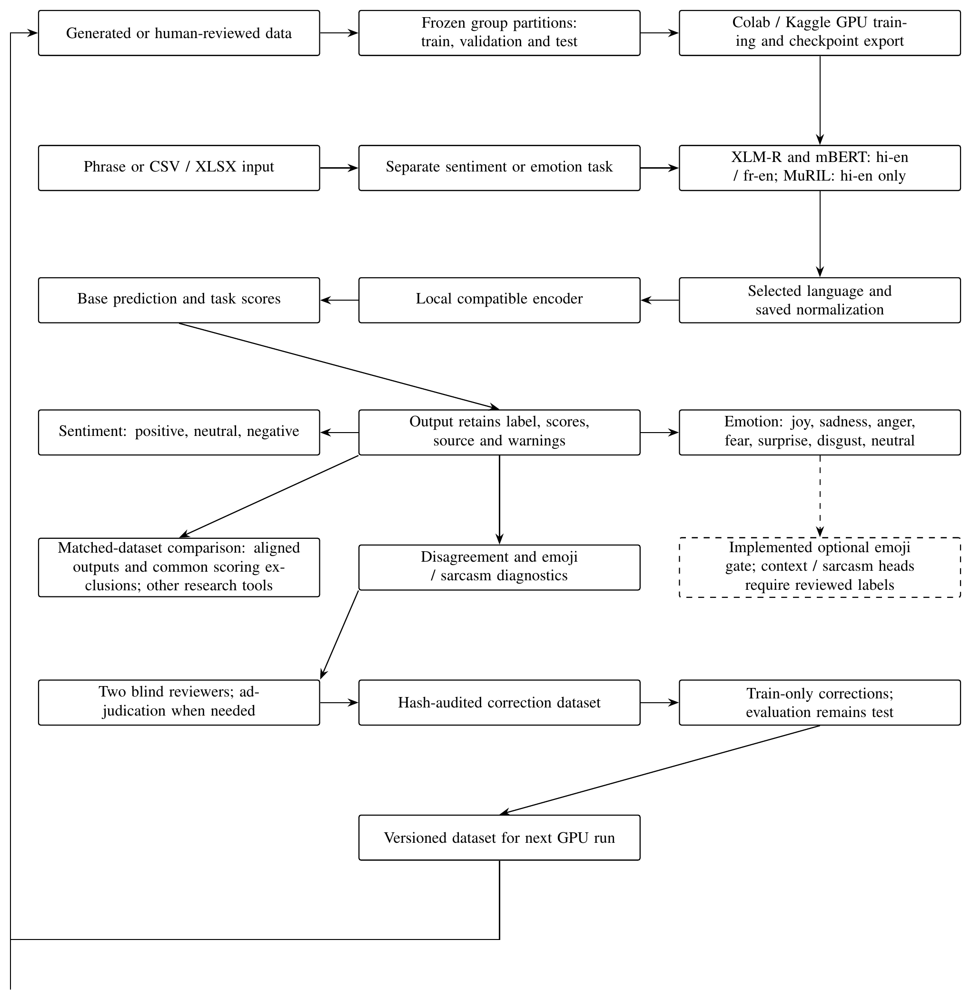
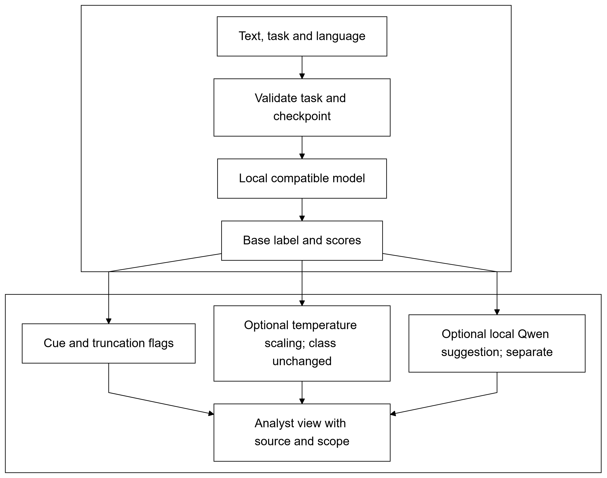
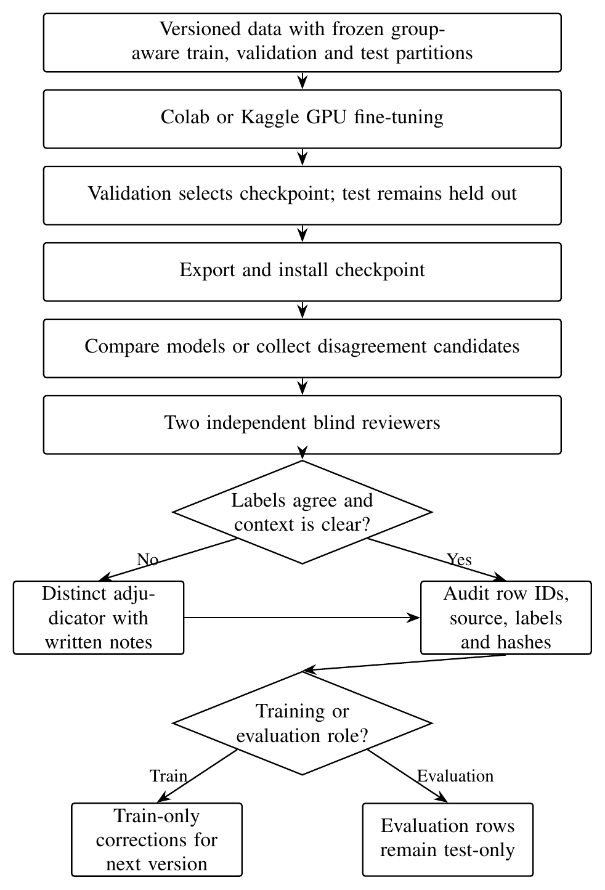
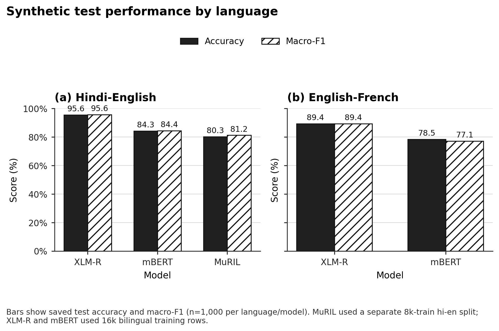
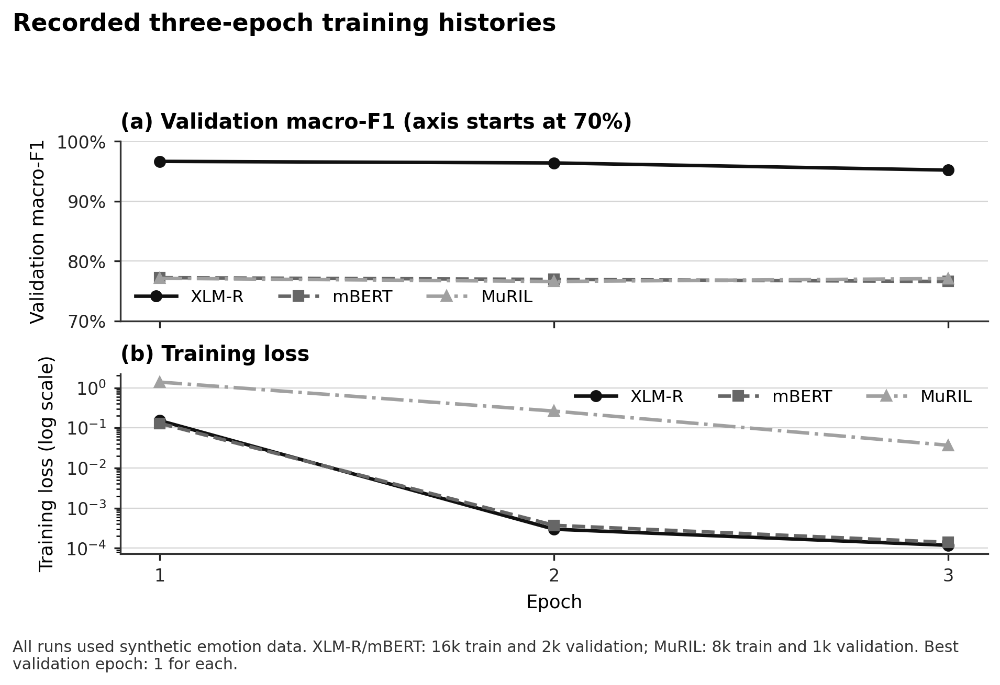

# CodeMood Multilingual Emotion Detection

## Abstract

Informal mixed-language messages combine spelling variation, language switching, emoji and context-dependent meaning, making emotion classification difficult to interpret and evaluate. We present CodeMood, a local system for seven-class emotion detection in Hindi-English and English-French text. The system connects language-compatible transformer checkpoints, conservative text preparation, emoji and sarcasm diagnostics, optional local language-model review, and file-based evaluation. A research interface adds sequential encoder comparison, disagreement analysis, confidence scaling, controlled input experiments and an audited human-review-to-training workflow. Training is separated from local inference through reproducible graphics-processor notebooks with frozen data partitions, checkpoint selection and inference exports. On 2,000 held-out synthetic bilingual phrases, the combined cross-lingual encoder obtains 92.5% accuracy and 0.9251 macro-averaged F1, compared with 81.4% and 0.8119 for multilingual BERT on the same partition. The Indian-language encoder obtains 80.3% accuracy on its 1,000-phrase Hindi-English test partition. Separate checking phrases expose substantial distribution sensitivity, while a 98-row validation experiment demonstrates confidence scaling without changing predicted labels. The contribution is an integrated, inspectable workflow whose results retain model identity, data scope and review provenance. The reported scores characterize the generated evaluation sets rather than population-level accuracy on naturally written messages.

**Keywords:** code-mixed emotion recognition, multilingual encoders, model disagreement, confidence calibration, reproducible training.

## 1 Introduction

A phrase such as "aaj presentation mast tha" combines Hindi syntax, English vocabulary and informal Roman spelling. Elongated forms such as "acchaaa" may express emphasis, hesitation or irony. An emoji may reinforce the words or conflict with them, while "great, another delay" can reverse its literal positive wording. Three-way sentiment gives a broad positive, negative or neutral direction; it does not distinguish sadness from anger, fear or disgust. A useful interface must therefore identify the task, expose uncertainty and preserve the evidence used to produce a result.

Multilingual contextual encoders offer a practical starting point because they learn token representations across languages [@devlin2019,conneau2020,khanuja2021]. Their pretrained representations still require supervised task adaptation. A pretrained model identifier alone is not a seven-emotion classifier. Language coverage also differs: the Indian-language encoder is appropriate to the Hindi-English study, whereas the cross-lingual and multilingual encoders support the bilingual comparison considered here. The linguistic variability described by code-mixed resources makes evaluation on a distinct phrase set essential [@aguilar2020,vijay2018].

Our research question is how to connect these encoders into a reproducible local system while allowing a user to inspect model disagreement, ambiguous cues and training provenance. We implement four modules: language-aware preparation and checkpoint inference; cue analysis and selective contextual review; evaluation and encoder disagreement; and reproducible training with audited annotation handoff. A Streamlit dashboard connects the modules without duplicating classifier logic. Command-line entry points support dataset preparation, evaluation and checkpoint installation.

The principal systems contributions are a seven-label checkpoint contract with language checks, a sequential comparison interface that separates disagreement from uncertainty, and a review workflow that protects frozen evaluation examples during correction export. An additional implemented text-emoji fusion architecture provides a controlled extension point for learned emoji representations. We evaluate the installed text encoders and an experimental confidence profile, retaining original model scores when any reviewer is used. These are integration and evaluation contributions; neither encoder agreement nor a high score is treated as proof that a phrase has been interpreted correctly.

## 2 Literature Survey

### 2.1 Multilingual encoders and code mixed text

Prior research supplies the representations and evaluation principles for multilingual affect analysis. The present work extends their use through an integrated, inspectable workflow; these extensions concern implementation and experimental control, rather than new pretraining theory or superiority over published systems. Vaswani et al. introduced the attention-based Transformer [@vaswani2017]. We reuse this architectural foundation within locally loaded encoders and connect it to provenance-recorded emotion inference. Devlin et al. established BERT's pretrain-and-fine-tune approach [@devlin2019]; our adaptation supplies a seven-emotion output space, versioned text preparation and frozen training, validation and test partitions.

Pires et al. demonstrated multilingual BERT's transfer capabilities alongside language-pair limitations [@pires2019]. We address the corresponding deployment concern through language-compatible checkpoint discovery and explicit warnings when a language lacks verified test coverage. Conneau et al. introduced XLM-R and analyzed multilingual scaling trade-offs [@conneau2020]. Our application fine-tunes and evaluates this encoder on the same declared Hindi-English and French-English synthetic partitions used for mBERT, enabling comparison within that shared scope. Khanuja et al. designed MuRIL around Indian languages and transliterated text [@khanuja2021]. We preserve that specialization through a Hindi-English profile, rather than presenting its smaller, language-specific experiment as equivalent to the combined-language runs. XTREME emphasizes evaluation across languages and tasks [@hu2020]; our reporting adapts this principle through per-language results, class support and recorded evaluation scope.

LinCE centralizes code-switching resources and tasks [@aguilar2020]; we operationalize comparable input handling through explicit language-pair identifiers and task-specific validation. GLUECoS investigates code-switched evaluation and adaptation using generated data [@khanuja2020]. Our workflow adds dataset and split hashes, related-phrase grouping and an explicit synthetic-data opt-in, making the experimental distribution traceable. SentiMix defines three-way sentiment analysis for code-mixed tweets [@patwa2020]. We extend the application to a separate seven-class emotion task while retaining distinct label spaces and rejecting incompatible checkpoints. This is a task expansion, not evidence of higher accuracy: published sentiment results cannot serve as matched baselines for differently labelled emotion experiments.

### 2.2 Emotion emoji and sarcasm

Vijay et al. provide Hindi-English emotion annotations together with linguistic information about emotional expression [@vijay2018]. Our implementation carries language identity into seven-emotion data validation, training metadata and prediction records, including an explicit neutral class. It does not automatically reinterpret their corpus or add labels to it. GoEmotions establishes a much finer English emotion taxonomy [@demszky2020]; our response to this taxonomy mismatch is to enforce a declared seven-label schema instead of treating incompatible categories as interchangeable. Affect in Tweets distinguishes emotion, intensity and valence objectives [@mohammad2018]. Correspondingly, the application separates sentiment and emotion outputs and identifies its cue-based intensity estimate as experimental.

Felbo et al. show that emoji prediction can provide useful distant supervision [@felbo2017]. We implement a different, optional adaptation: learned emoji-sequence embeddings feed a residual gate alongside the text representation, with missing-emoji contribution forced to zero. Its accuracy contribution is unevaluated. Kralj Novak et al. supply an empirical emoji sentiment lexicon [@kraljnovak2015]; our workflow makes lexical emoji evidence inspectable and keeps that evidence distinct from the trained emotion prediction. Barbieri et al. benchmark emoji prediction in English and Spanish [@barbieri2018]. We extend diagnostic coverage through paired baseline and emoji-removal experiments, retaining predictions and requiring explicit expected labels or declared invariance before scoring altered inputs. This tests whether emoji removal changes behavior without assuming that emotion must remain constant.

Van Hee et al. distinguish binary and fine-grained irony using annotated tweets [@vanhee2018]. Our architecture similarly treats sarcasm supervision as separate from emotion: unknown binary labels are masked and an untrained head cannot supply a probability. Aggarwal et al. investigate supervised Hindi-English sarcasm detection [@aggarwal2020]; our training interface adds a human-review requirement for independently supplied binary labels and records the head's training language scope. These are supervision controls, not a reproduction of their model or an accuracy improvement over it.

Ghosh et al. demonstrate the usefulness of conversational context for sarcasm analysis [@ghosh2018]. We adapt this insight through bounded context input, current-message token priority and metadata that permits contextual encoder inference only for a context-trained checkpoint. MELD organizes affective labels within multi-party dialogue [@poria2019]; our text-only conversation interface adds speaker-specific emotion traces and preserves earlier-turn context with each prediction, without claiming multimodal equivalence. EDiReF separately evaluates conversational emotion and emotion-flip reasoning [@kumar2024]. Our interface records observed speaker-label changes while keeping them distinct from causal explanations of emotion flips. Independently validated context and sarcasm performance are therefore separate from the present synthetic-data results.

### 2.3 Confidence disagreement and evaluation

Guo et al. study neural miscalibration and temperature scaling [@guo2017]. We adapt scaling into a checkpoint-identity-bound profile, restrict fitting to validation or dedicated calibration rows, reject guarded training/test overlap, and preserve the predicted class. Ovadia et al. show that uncertainty quality can deteriorate under dataset shift [@ovadia2019]. Our profile records data scope and synthetic status and exposes limitations, addressing accidental reuse of an apparently universal confidence correction without claiming to solve distribution shift. Lakshminarayanan et al. demonstrate uncertainty estimation with deep ensembles [@lakshminarayanan2017]. Our resource-constrained alternative runs heterogeneous local checkpoints sequentially and displays their individual distributions; it is a disagreement inspection tool, not a reproduced deep-ensemble estimator. Lin's entropy-based divergences provide the mathematical foundation for Jensen-Shannon comparison [@lin1991]. We apply that measure and its square-root distance to aligned seven-class distributions alongside predicted-label disagreement.

Geifman and El-Yaniv formalize selective prediction's risk-coverage trade-off [@geifman2017]. We translate the operational idea into explicit review-routing reasons, review coverage and timing records, while treating configured thresholds as heuristics rather than certified risk guarantees. Davani et al. preserve individual annotator judgments through multi-annotator modeling [@davani2022]. Our complementary data workflow creates two blinded reviewer sheets, separates proposed model labels and requires adjudication where appropriate before correction export. Plank argues that human label variation can reflect legitimate interpretation differences [@plank2022]. We retain reviewer identities, notes and requests for context so that ambiguity remains inspectable instead of being silently replaced by model consensus.

Gebru et al. propose systematic dataset documentation [@gebru2021]; we operationalize provenance through audited correction exports that retain synthetic origin and allow reviewed additions into training while protecting frozen validation and test partitions. Bender and Friedman connect linguistic data statements to defensible generalization claims [@bender2018]. Our checkpoint records distinguish trained language coverage from verified evaluation coverage and preserve preprocessing settings. Ribeiro et al.'s CheckList tests capabilities beyond aggregate accuracy [@ribeiro2020]; our experiment runner supplies raw, normalized, emoji-removed and context variants with per-row outcomes, overlap checks and explicit label-validity rules. Dror et al. explain that significance tests must match the experimental design [@dror2018]. Our shared splits and paired prediction records support such comparisons, but no statistical superiority is inferred from unmatched runs. XLM-R and mBERT use 16,000/2,000/2,000 synthetic examples across two language pairs; MuRIL uses 8,000/1,000/1,000 Hindi-English examples. The methodological extension is an auditable path from prediction to diagnosis, review and controlled retraining, with performance claims restricted to the measured scope.

## 3 Proposed System

CodeMood accepts one phrase, a bounded conversation, or a structured CSV/XLSX file. The request includes a task and language mix. Three-class sentiment and seven-class emotion use separate output contracts. The selected local checkpoint is validated before tokenization; missing or incompatible artifacts produce an explicit interface message. Normalization, lexical cues, calibration, reviewer suggestions and model outputs retain distinct sources. The full architecture is shown in Fig. 1.

The application contains seven workspaces: Overview, Analyze text, Emotion lab, Model effectiveness, Dataset explorer, Model disagreement and Research workbench. Recent live analyses remain in session memory until the user exports them. Dataset and correction downloads require an explicit action; a prediction does not mutate training data or model weights. Model identity, task, supported language pairs, preparation policy and artifact fingerprints accompany the inference route.

### 3.1 Module 1 Language preparation and seven emotion inference

The normalizer handles common Romanized spellings conservatively, records elongated forms, and preserves negation. It retains both the original phrase and the normalized candidate. A checkpoint's metadata determines whether raw or normalized text reaches its tokenizer. This prevents a convenient interface transformation from silently changing the preprocessing used during training. Token-length limits are enforced, and truncation is surfaced with the result.

The installed classifiers are a combined XLM-R checkpoint, a bilingual mBERT checkpoint, a Hindi-English MuRIL checkpoint and an original Hindi-English XLM-R checkpoint. Each consists of its tokenizer, encoder, trained classification head, label map and task metadata. The encoder produces a contextual vector h. The classification head maps h to seven logits z using learned weights and bias. For class k, `p_k` is its normalized score, and y-hat is the selected emotion.

[[equation:softmax]]

[[equation:argmax]]

The trained head assigns one logit to each emotion: joy, sadness, anger, fear, surprise, disgust and neutral. Softmax converts these logits into nonnegative scores that sum to one; the largest score determines the displayed base label. The maximum is neither measured emotion intensity nor independently verified correctness probability. The same seven-point specification is shared by training, inference and exported files.

| Checkpoint output | Meaning in the task |
|---|---|
| joy | Happiness, satisfaction or positive delight |
| sadness | Loss, disappointment or sorrow |
| anger | Frustration, irritation or hostility |
| fear | Anxiety, apprehension or perceived threat |
| surprise | Unexpectedness or astonishment |
| disgust | Aversion or strong rejection |
| neutral | No dominant target emotion in the phrase |

These seven labels describe the expressed or perceived content under the dataset convention; they are not a psychological assessment of the writer. Softmax scores form a seven-element distribution. They are neither seven independent diagnoses nor measured emotional intensity. Checkpoint validation rejects a three-class sentiment head used as a seven-emotion head and checks that the requested language is compatible with the export.

The implemented fusion variant adds a learned emoji branch to the XLM-R text vector. Emoji sequences, including modifiers and joined sequences, are mapped to versioned hash buckets, embedded, pooled and projected. A learned vector gate forms a residual text-plus-emoji representation. When the phrase contains no emoji, the gate contribution is forced to zero. This design differs from the lexical emoji conflict diagnostic: one is a trainable representation, the other is a transparent rule cue. Optional context is encoded using the current phrase first and the remaining token budget for earlier turns. An auxiliary binary sarcasm head shares the fused representation and masks rows without independently reviewed sarcasm labels. The quantitative encoder study in this paper concerns the installed text-only checkpoints; it does not attribute those scores to the fusion variant.

**Algorithm 1 Seven emotion checkpoint inference**

```text
Input: phrase x, language l, checkpoint c
1. Validate c.task, seven labels and language l.
2. Preserve x; compute normalization record n.
3. Choose raw x or n.text from c.metadata.
4. Tokenize within c.max_length; flag truncation.
5. Encode tokens and apply the trained head.
6. If c enables fusion, add gated emoji state.
7. Normalize logits into seven probabilities p.
8. Return argmax(p), p, source and warnings.
```



### 3.2 Module 2 Cue analysis confidence and contextual review

A separate diagnostic path extracts lexical polarity, elongation, negation and emoji cues. Word-only polarity is compared with emoji polarity to describe agreement, conflict or ambiguity. Sarcasm uses a labelled heuristic baseline unless an independently supervised sarcasm model is explicitly installed. Valence/arousal intensity and evidence words are shown as heuristic outputs; they are not presented as transformer attention or feature attribution.

Uncertainty routing considers the top score, the gap between the two leading scores, truncation, contextual input, experimental language scope, emoji conflict and sarcasm cues. For the score rule, a top score below 0.55 or a margin below 0.15 marks an uncertain result. These thresholds are operational choices rather than calibrated error guarantees. A matching temperature profile rescales the stored scores. In the equation below, T is the fitted temperature and the denominator renormalizes all seven classes.

[[equation:temperature]]

Scaling stored probabilities is equivalent to softmax of log probabilities divided by temperature. Zero entries remain zero. A temperature above one generally softens the distribution, while a value below one sharpens it. Positive scalar scaling preserves class ordering; it changes confidence scores rather than repairing a wrong label. The implementation restricts T to the interval [0.05, 20] and fits it using validation or dedicated calibration data. The profile remains bound to its checkpoint, language and preparation settings [@guo2017].

The local reviewer uses Ollama with Qwen3 0.6B. It receives the current phrase, earlier context when supplied, the base result and cue summaries. Structured output is checked for a valid emotion, sarcasm flag and evidence spans. The interface retains the base distribution alongside any reviewed suggestion. Reviewer failure is recorded without replacing the base result. A conversation trace stores turn order and speaker identity and tracks speaker-specific label changes. Existing text-only checkpoints still process each current phrase individually; optional context can influence the reviewer, while context-conditioned encoder inference is restricted to checkpoints trained for that input contract.



**Algorithm 2 Selective local review**

```text
Input: base prediction p, text x, context h
1. Extract lexical, emoji and sarcasm cues q.
2. If a matching profile exists, scale p to pT.
3. Flag low top score, small margin or truncation.
4. Add conflict, context and scope reasons.
5. If review is off or no reason, return base.
6. Check local reviewer availability.
7. Request and validate a structured suggestion.
8. Return base plus suggestion, reasons and status.
```

### 3.3 Module 3 Evaluation experiments and model disagreement

File evaluation accepts a text column, optional gold emotion labels, language identifiers and optional split metadata. With labels, it computes accuracy, macro-F1, per-class scores, confusion matrices and language slices. Without labels, it returns predictions and distributions rather than inventing accuracy. If a split column is supplied, the test partition is the default evaluation scope. Normalized text hashes are compared with frozen training and validation guards, and overlap is reported before interpretation.

The disagreement view loads compatible checkpoints sequentially to reduce simultaneous memory use. Hindi-English can compare XLM-R, mBERT and MuRIL; English-French compares the two multilingual encoders. Top-label disagreement is distinct from low confidence. Let P and Q be the aligned seven-class score distributions from two checkpoints and M their midpoint. KL is Kullback-Leibler divergence; only terms with positive `P_k` are summed. The logarithm has base two [@lin1991].

[[equation:js_mixture]]

[[equation:kl]]

[[equation:js]]

[[equation:js_distance]]

The comparison aligns the same seven labels and normalizes each nonnegative vector before forming its midpoint. Base-two logarithms make divergence interpretable on a bounded scale; zero-probability terms are omitted. Distance takes the square root, with a numerical floor guarding against round-off. Larger disagreement does not identify which checkpoint is correct. Zero divergence means identical distributions; the divergence and its square-root distance lie between zero and one.

Controlled experiments compare raw text, normalized text and emoji-removed text, with optional context and no-context variants. A changed input receives accuracy only when its own label is supplied or label invariance is explicitly declared. Otherwise the reported measure is prediction stability. Reviewer modes compare no review, selective review and review-all, with the same-reviewed-subset before/after scores, review coverage and latency. Interactive runs are bounded to 200 phrases and five reviewer calls; the disagreement view is bounded to 20 phrases. These limits keep local demonstration costs understandable.

**Algorithm 3 Sequential disagreement analysis**

```text
Input: phrases X, language l, checkpoints C
1. Keep trained checkpoints compatible with l.
2. For each c in C, load c once.
3. Predict seven-class distributions for X.
4. Store labels, scores, warnings and c identity.
5. Release c before loading the next model.
6. For each phrase, compare top labels.
7. Compute pairwise JS divergence and distance.
8. Return disagreement and uncertainty separately.
```

### 3.4 Module 4 Cloud training and audited annotation handoff

Training runs on a cloud graphics processor, while the local application performs inference and analysis. The notebooks install the packaged source, verify dataset hashes, preserve frozen partitions and select a checkpoint by validation macro-F1. Each completed epoch stores model, optimizer and random-state recovery artifacts. The inference export includes weights, tokenizer, configuration and metadata, while excluding optimizer state and training rows. The local installer validates the export and preserves an existing model instead of overwriting it silently.

For class c, `n_train` is the number of training rows and `n_c` is its training support. The class weight `w_c` and the weighted loss for microbatch B are defined below; `y_i` is the supplied class of phrase i.

[[equation:class_weights]]

[[equation:weighted_ce]]

Class weights are computed from training labels only, increasing the relative contribution of less frequent classes. The count floor matches the implementation safeguard. Computed stably from logits, PyTorch takes a weighted mean: its denominator is the sum of target weights in the microbatch, not the number of rows. Gradient accumulation scales and averages these microbatch losses. Setting class weights to none gives the ordinary unweighted mean cross-entropy.

Google Colab is the primary training environment, with a separate Kaggle notebook for the advanced XLM-R experiment. The operational sequence is to upload the notebook, choose a GPU runtime, run its cells in order, upload the matching source/data ZIP, configure persistent storage, and start the chosen training job. Validation is checked after each epoch; the best checkpoint is evaluated on the fixed test partition after model selection. The user then downloads the inference ZIP, installs it from the project root and selects the new checkpoint in Emotion lab. Recovery resumes from the latest completed epoch when the same data and settings are restored. Dataset and source manifests make these steps reproducible without training on the laptop.

The human-review path creates two independent blank annotation sheets and keeps proposed labels separate. Distinct reviewers label each phrase. Disagreement or a context flag requires a third adjudicator and a written reason. A completed export binds the reviewed CSV to an audit receipt and the source sheet hashes. The dataset builder accepts only eligible training-role corrections, rejects overlap with held-out rows and evaluation phrases, and preserves synthetic ancestry. It downloads a versioned dataset for an explicit GPU run; a review action is not an automatic model update. Reviewer identifiers provide a consistency check, while actual independence is a procedural responsibility of the team.



**Algorithm 4 Audited correction dataset export**

```text
Input: base data D, sheets A and B, audit r
1. Match source rows, roles and reviewer IDs.
2. Reconcile independent labels in A and B.
3. Require adjudication for conflicts or flags.
4. Verify completed receipt and source hashes.
5. Select reviewed rows with training role only.
6. Reject held-out text, ID or group leakage.
7. Merge eligible corrections into D.train.
8. Preserve D.validation and D.test unchanged.
9. Export versioned CSV, audit and GPU guide.
```

## 4 Results and Implementation

### 4.1 Dataset description and experimental configuration

The bilingual bootstrap contains 20,000 synthetic phrases, equally divided between Hindi-English and English-French. Its frozen partitions contain 16,000 training, 2,000 validation and 2,000 test rows. Each language contributes 8,000/1,000/1,000 rows. XLM-R and mBERT use the same dataset and split hashes. MuRIL uses the Hindi-English subset, with 8,000 training rows, 1,000 validation rows and 1,000 test rows. The original Hindi-English XLM-R checkpoint uses the earlier 8,000/1,000/1,000 experiment and is treated separately from the combined study.

| Data resource | Train / validation / test | Purpose |
|---|---|---|
| Bilingual synthetic bootstrap | 16,000 / 2,000 / 2,000 | XLM-R and mBERT comparison |
| Hindi-English synthetic subset | 8,000 / 1,000 / 1,000 | MuRIL study |
| Separate checking drafts | 100 hi-en and 100 fr-en | Diagnostic phrase tests |
| Calibration subset | 98 hi-en validation rows | Temperature fitting only |

The checking files contain spelling variation, negation, indirect affect, emoji conflict, neutral statements and sarcastic wording. Their expected labels are unreviewed draft labels, so their scores are diagnostic. Exact normalized overlap with the recorded 20,000-row corpus and installed guards is zero. This protects against exact reuse but does not prove independence of templates, paraphrases or semantics. The calibration subset contains fourteen rows per emotion drawn from Hindi-English synthetic validation data; frozen train, test and checking hashes are excluded. It is not a new test set.

All three completed model families use full encoder fine-tuning with class-balanced loss, a maximum of 128 tokens, random seed 42, learning rate 0.00002, microbatch size 2, gradient accumulation of 8 and half-precision training on a CUDA device. The effective update batch is sixteen examples. Three epochs were recorded and the first epoch had the highest validation macro-F1 for each model. Raw-text preparation is stored in checkpoint metadata. The saved metrics, exported labels and split manifests are checked together rather than inferred from a model directory name.

### 4.2 Module 1 Inference and seven class outputs

Installed checkpoints return the same seven labels and language-compatible results through phrase and batch interfaces. The combined XLM-R model achieves 95.6% Hindi-English accuracy and 89.4% English-French accuracy on their 1,000-row synthetic test slices. Corresponding mBERT accuracies are 84.3% and 78.5%. MuRIL obtains 80.3% on its Hindi-English test. The checkpoint contract, truncation messages and task checks provide reproducible behavior across the interface and exported files.

Class-specific F1 provides a finer view than the aggregate. The table below uses each model's recorded test scope; XLM-R and mBERT columns are bilingual, whereas MuRIL is Hindi-English only.

| Emotion | XLM-R F1 | mBERT F1 | MuRIL F1 |
|---|---:|---:|---:|
| joy | 1.0000 | 0.8927 | 0.6573 |
| sadness | 0.8659 | 0.6837 | 0.6300 |
| anger | 0.8958 | 0.7861 | 0.9167 |
| fear | 0.8841 | 0.7774 | 0.7521 |
| surprise | 0.8748 | 0.7317 | 0.7865 |
| disgust | 0.9549 | 0.8410 | 0.9437 |
| neutral | 1.0000 | 0.9707 | 1.0000 |

Sadness is weaker than joy or neutral for both bilingual models. MuRIL's anger and disgust scores are stronger than its joy and sadness scores within its own test scope. Perfect scores on selected generated classes should be read as properties of these test patterns, not as evidence of perfect performance on ordinary messages. The differences motivate class-level inspection instead of one advertised accuracy number.

### 4.3 Module 2 Confidence and reviewer behavior

The 98-row validation fitting experiment estimates temperature T = 2.6461 for mBERT. Negative log-likelihood decreases from 1.5044 to 0.7879, Brier score from 0.4232 to 0.3578 and expected calibration error from 0.2165 to 0.0441. Predicted labels and classification accuracy are unchanged because scalar temperature preserves their ordering. These are measurements on the fitting subset; they do not establish transfer calibration on another domain.

| Confidence measure | Before | After |
|---|---:|---:|
| Negative log-likelihood | 1.5044 | 0.7879 |
| Brier score | 0.4232 | 0.3578 |
| Expected calibration error | 0.2165 | 0.0441 |

A local Qwen call successfully exercised structured review, and unavailable-service behavior retains the base prediction. Its comparative accuracy is not estimated by the encoder tables. This distinction matters because a reviewer suggestion can be fluent and still wrong. Emoji conflict, heuristic sarcasm, evidence words and intensity remain labelled as separate signals. Conversation traces correctly use earlier turns rather than future turns and retain speaker-specific transitions; their curves represent model outputs, not measured mental-state trajectories.

### 4.4 Module 3 Evaluation and disagreement diagnostics

The file evaluator reproduces mBERT's complete 2,000-row synthetic test result on local CPU inference: 81.4% accuracy and 0.8119 macro-F1. It also exposes the contrast between generated training-style phrases and a separate checking set. Against the unreviewed checking labels, mBERT scores 50/100 Hindi-English and 41/100 English-French; MuRIL scores 51/100 Hindi-English. The figures are not interchangeable with the controlled synthetic test scores because source distributions and label reliability differ.

| Checking set | Model | Correct / rows |
|---|---|---:|
| Hindi-English drafts | mBERT | 50 / 100 |
| English-French drafts | mBERT | 41 / 100 |
| Hindi-English drafts | MuRIL | 51 / 100 |

A manually inspected happy phrase, "Aaj main bahut khush hoon!" receives a sadness prediction from mBERT with approximately 99.94% base score. In the disagreement view, other installed encoders can return joy for this same example. This illustrates the value of exposing alternatives and score distributions; it is not a statistical estimate of which encoder will win on a new population. The experiment interface further allows normalization, emoji removal and reviewer policies to be compared on the same supplied rows without treating changed-input labels as automatically valid.

### 4.5 Module 4 Training export and workflow verification

The notebooks produced installable text-encoder checkpoints with best-epoch selection, saved metrics and task metadata. Local CPU replay verifies that exported mBERT inference matches its recorded test aggregate. The advanced trainer's data validation reproduces the 16,000/2,000/2,000 partitions and recognizes that the current bootstrap has no reviewed context or sarcasm supervision. Emotion-plus-emoji training can use the explicit synthetic experiment configuration; contextual and auxiliary objectives are enabled only by their own reviewed annotation fields.

Software verification covers preparation, label maps, file evaluation, leakage checks, model discovery, unavailable local services, calibration, disagreement, review reconciliation and the dashboard. The complete offline suite passes 221 tests and 33 subtests. A compact SafeTensors fixture is exported, installed and used for local fusion inference to check the artifact path. Gradient tests verify the learned gate and zero emoji contribution when no emoji is present. Notebook cells and package manifests are checked before cloud execution. These tests establish implementation behavior; they do not replace an empirical effectiveness study of a newly trained fusion model or a reviewed correction dataset.

## 5 Performance and Metrics

### 5.1 Accuracy and macro averaged F1

Each emotion is evaluated against the other six classes. A true positive is a correctly predicted instance of the selected emotion. A false positive assigns that emotion to another class, while a false negative misses a supplied instance of it. Counts depend on the supplied file's annotation quality and evaluation scope. For example, with sadness as the selected class, a joyful phrase predicted as sadness is a false positive; a sadness phrase predicted as neutral is a false negative.

[[equation:precision]]

[[equation:recall]]

[[equation:f1]]

Precision measures how often predictions of an emotion are correct; recall measures how many supplied instances of that emotion are recovered. F1 is their harmonic mean, so both kinds of error matter. The evaluator assigns zero whenever a denominator is zero. F1 summarizes classification outcomes over labelled rows: it is neither the confidence score of an individual phrase nor the fraction of all rows classified correctly. Both precision and recall, and therefore F1, range from zero to one; higher is better on the stated evaluation data.

[[equation:macro_f1]]

[[equation:accuracy]]

Here k indexes the seven emotions, N is the number of labelled phrases, and I is an indicator equal to one for a correct prediction and zero otherwise. Macro-F1 gives every emotion equal weight, including a class whose F1 is zero. Accuracy instead gives each evaluated row equal weight. The two measures can therefore differ when classes have unequal support or errors concentrate in particular emotions. Reporting both with class support and a confusion matrix avoids hiding a weak class behind a strong overall average. A macro-F1 of 0.9251 is an average class score; it does not mean that 92.51% of individual phrases were classified correctly.

**Worked example for sadness**

For illustration, suppose sadness has eight true positives, two false positives and four false negatives. Precision is 8/10 = 0.80, while recall is 8/12 = 0.6667. Substituting these counts into the F1 formula gives 16/(16 + 2 + 4) = 16/22, approximately 0.7273. This hypothetical calculation explains the metric and is not an additional checkpoint result.

[[equation:worked_f1]]

The following comparison uses the same 2,000 bilingual synthetic test rows for the lexical baseline, combined XLM-R and mBERT. This is the appropriate comparison between the existing rule methodology and the proposed system configured with a trained encoder. Optional reviewer or fusion branches are not credited with this result.

| Method on bilingual test | Accuracy | Macro-F1 |
|---|---:|---:|
| Existing lexical baseline | 37.55% | 0.3765 |
| System with mBERT | 81.40% | 0.8119 |
| System with combined XLM-R | 92.50% | 0.9251 |

The XLM-R configuration improves accuracy by 54.95 percentage points over the lexical baseline and by 11.10 points over mBERT on this partition. Its macro-F1 lead over mBERT is approximately 0.1131. These are observed differences for the recorded experiment, not significance-tested population effects. Hindi-English XLM-R exceeds its English-French score by 6.2 points, showing that multilingual capability does not imply equal task performance across language mixes.



MuRIL is reported only for Hindi-English. Its 80.3% accuracy and 0.8123 macro-F1 should not be merged into a bilingual overall result. Its smaller training scope also prevents an encoder-only causal comparison with the bilingual models. The original Hindi-English XLM-R run records 90.7% accuracy on its own 1,000-row synthetic test and serves as an earlier single-language configuration; it is not substituted for the combined checkpoint's language slice.

### 5.2 Learning behavior and checkpoint selection

The highest validation macro-F1 values are 0.9666 for combined XLM-R, 0.7723 for mBERT and 0.7712 for MuRIL, all at epoch one. XLM-R training loss falls from approximately 0.1517 to 0.000118 across three epochs, while validation macro-F1 declines to approximately 0.9520. The widening contrast between training fit and validation behavior supports selecting the best validation checkpoint rather than automatically using the last epoch.



mBERT and MuRIL show a similar need for validation-based selection even though their loss trajectories differ. A low training loss measures fit to the training objective and cannot by itself establish generalization. The notebook therefore keeps the best model for inference while retaining the newest completed epoch for recovery. Test metrics are computed after selection, keeping their role separate from tuning.

### 5.3 Interpreting effectiveness

Confidence quality is evaluated separately from label correctness. In the following equations, p denotes the distribution being assessed: base scores, or rescaled scores after the chosen temperature profile. The expression `p_i,y_i` is the score assigned to the supplied target for phrase i, and N is the number of measured rows.

[[equation:nll]]

NLL penalizes low probability assigned to the supplied target, with a particularly large penalty for confident mistakes. The implementation uses the natural logarithm and floors only the target probability at 10 to the power minus 300 before taking its log. Lower values indicate better target-probability fit on the evaluated rows. Improvement on the temperature-fitting subset is not independent evidence of calibration on another distribution. The numerical floor is `epsilon_floor`.

[[equation:brier]]

Here `y_ik` is a one-hot target: one for the supplied emotion and zero for the other six classes. The Brier score compares the full predicted distribution with the one-hot target vector, penalizing squared errors across all seven classes. The implementation sums class errors and then averages across rows; it does not divide by seven. This convention matters when comparing numerical scores with other sources. Lower is better on the stated data, but a lower fitting-set score alone does not establish transfer calibration.

[[equation:ece]]

`B_b` is a confidence bin, |`B_b`| is its row count, `acc(B_b)` is its correctness fraction and `conf(B_b)` is its mean maximum score. Rows are grouped by their maximum rescaled score into ten equal-width intervals: [0, 0.1), [0.1, 0.2), and so on, with the final interval [0.9, 1] including one. Empty bins contribute nothing. ECE weights each bin's absolute accuracy-confidence gap by its share of rows. It is a bin-dependent summary of score reliability, not an individual phrase confidence or a distribution-free guarantee. A bin with mean score 0.90 and observed accuracy 0.70 contributes its row share multiplied by 0.20. Lower NLL, Brier and ECE are preferable within the same declared evaluation scope.

Disagreement uses top-label differences and Jensen-Shannon distance. Reviewer experiments additionally record coverage and latency. Each measure answers a different question, so the interface does not combine them into an unsupported single effectiveness score.

The strongest supported finding is that the combined XLM-R checkpoint fits the recorded bilingual synthetic task more effectively than the lexical baseline or mBERT configuration. The checking phrases reveal distribution sensitivity and confident mistakes. The calibration example shows improved fitting-set score calibration without correcting labels. Exact text guards, source metadata and annotation receipts improve experimental traceability but do not certify representative language coverage or label quality. No measured accuracy gain is assigned to optional fusion, human correction or contextual review without a corresponding controlled run.

## 6 Conclusion

CodeMood integrates local phrase and file analysis, seven-class emotion checkpoints, conservative text preparation, emoji and sarcasm diagnostics, optional contextual review, encoder disagreement and reproducible cloud training. Four modules connect these capabilities through shared label and artifact contracts. The local application preserves base predictions and exposes model identity, uncertainty, overlap and review provenance, while audited correction exports keep held-out examples separate from training updates.

On the fixed bilingual synthetic test, the combined XLM-R configuration obtains 92.5% accuracy and 0.9251 macro-F1, compared with 81.4% and 0.8119 for mBERT and 37.55% and 0.3765 for the lexical baseline. MuRIL provides a separate Hindi-English comparison at 80.3% accuracy. Validation curves justify best-epoch selection, and checking phrases demonstrate why these scores cannot be generalized to natural messages without independent evaluation. The implemented calibration, experiment and annotation workflows make that evaluation inspectable. The system's contribution is the connection between multilingual inference, transparent diagnostics and controlled model-development procedures, with each empirical claim tied to its actual dataset and configuration.

## References
